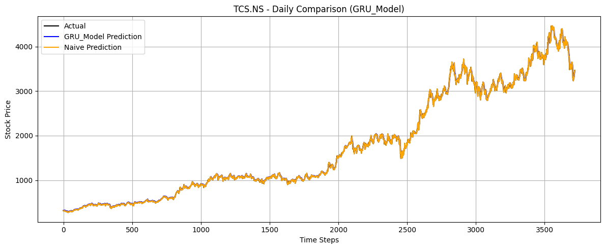
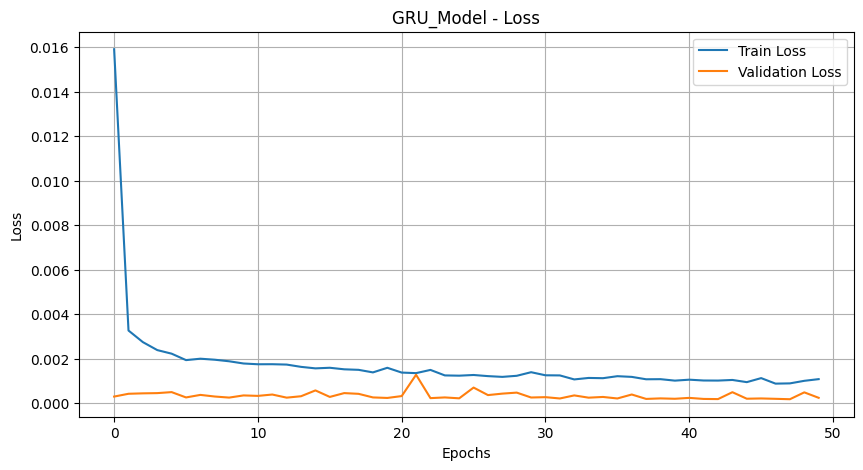

# TCS Stock Price Forecasting with LSTM and GRU

Forecasting the daily closing price of **Tata Consultancy Services (NSE: `TCS.NS`)** with four recurrent neural network architectures, compared against a naive "tomorrow = today" baseline at daily, weekly and monthly granularity.


> Course-based project for **Machine Learning**, B.Tech Computer Science and Engineering,
> VNR Vignana Jyothi Institute of Engineering & Technology, Hyderabad (2024–25).

---

## Overview

| | |
|---|---|
| **Data** | TCS.NS daily OHLCV prices from Yahoo Finance (`yfinance`), 1 Jan 2015 – 30 Apr 2025 (2,548 trading days) |
| **Target** | Next-day closing price |
| **Input** | Previous 60 closing prices (sliding window), scaled to [0, 1] with `MinMaxScaler` |
| **Models** | Vanilla LSTM, Bidirectional LSTM, Stacked LSTM, GRU |
| **Baseline** | Naive persistence forecast (next value = current value) |
| **Metrics** | MAE, RMSE, R² |

## Models

All models are Keras `Sequential` networks ending in a single `Dense(1)` output, trained with the Adam optimizer on mean squared error.

| Model | Recurrent layers | Units per layer | Dropout |
|---|---|---|---|
| Vanilla LSTM | 2 × LSTM | 50 | 0.2 |
| Bidirectional LSTM | 2 × Bidirectional(LSTM) | 50 per direction | 0.2 |
| Stacked LSTM | 3 × LSTM | 100 | 0.3 |
| GRU | 2 × GRU | 50 | 0.2 |

**Training setup:** 80/20 train–test split, up to 50 epochs, batch size 32, 10% validation split, early stopping on validation loss (patience 10, best weights restored).

## Results

Each trained model is run over the full TCS.NS price history (2010–2025) at three intervals and compared with the naive baseline. Prices are in INR.

### Daily

| Model | MAE | RMSE | R² |
|---|---:|---:|---:|
| Vanilla LSTM | 44.29 | 64.87 | 0.9970 |
| Bidirectional LSTM | 38.90 | 52.79 | 0.9980 |
| Stacked LSTM | 36.21 | 51.53 | 0.9981 |
| **GRU** | **25.73** | **38.22** | **0.9990** |
| Naive baseline | 18.42 | 29.65 | 0.9994 |

### Weekly

| Model | MAE | RMSE | R² |
|---|---:|---:|---:|
| Vanilla LSTM | 86.58 | 129.28 | 0.9877 |
| Bidirectional LSTM | 88.38 | 117.60 | 0.9898 |
| Stacked LSTM | 73.60 | 107.67 | 0.9914 |
| **GRU** | **54.53** | **81.48** | **0.9951** |
| Naive baseline | 45.77 | 68.76 | 0.9965 |

### Monthly

| Model | MAE | RMSE | R² |
|---|---:|---:|---:|
| Vanilla LSTM | 213.15 | 295.25 | 0.9208 |
| Bidirectional LSTM | 258.63 | 312.18 | 0.9115 |
| Stacked LSTM | 157.95 | 222.14 | 0.9552 |
| **GRU** | **120.90** | **171.93** | **0.9731** |
| Naive baseline | 115.10 | 156.46 | 0.9778 |

All values are also in [`results/metrics.csv`](results/metrics.csv).

### Key findings

- **GRU is the strongest neural model at every interval**, ahead of the Stacked LSTM, despite having fewer parameters.
- **The naive baseline beats every neural model on all three intervals.** This is typical for stock prices, which behave close to a random walk: the best single guess for tomorrow's price is usually today's price. High R² values (> 0.99) mostly reflect the long-term upward trend, not real predictive skill.
- Error grows sharply from daily to monthly data, since the models were trained on daily sequences only.

### Sample plots

| Daily: GRU vs actual | GRU training loss |
|---|---|
|  |  |

All 16 plots (4 loss curves, 12 prediction comparisons) are in [`results/`](results/).

## Repository structure

```
TCS-Stock-Price-Forecasting/
├── notebooks/
│   └── TCS_Stock_Forecasting_LSTM.ipynb   # full pipeline with outputs
├── data/
│   └── TCS_historical_2020-2025.xlsx      # reference export (Equitypandit), May 2020 – May 2025
├── results/
│   ├── metrics.csv                        # all MAE / RMSE / R² values
│   ├── loss_curves/                       # training vs validation loss per model
│   ├── daily/  weekly/  monthly/          # predicted vs actual price plots
├── requirements.txt
├── LICENSE
└── README.md
```

The notebook downloads its data directly from Yahoo Finance, so the spreadsheet in `data/` is not needed to run it.

## Getting started

```bash
git clone https://github.com/darlavimalakeerthana05/tcs-stock-price-forecasting.git
cd tcs-stock-price-forecasting

python -m venv venv
source venv/bin/activate          # Windows: venv\Scripts\activate
pip install -r requirements.txt

jupyter notebook notebooks/TCS_Stock_Forecasting_LSTM.ipynb
```

Or open the notebook in **Google Colab** (it was developed there) and run all cells. Trained models are saved to `saved_models/`, which is git-ignored.

## Limitations and future work

- **Time-ordered split.** The train–test split currently shuffles the 60-day windows, so the model sees windows from later dates during training. A chronological split (train on earlier years, test on later ones) would give a stricter, more realistic test.
- **Out-of-sample evaluation.** The comparison runs over the full price history, which overlaps the training data. Reporting metrics on a held-out recent period only would better reflect forecasting performance.
- **Scaler fitting.** `MinMaxScaler` is fit on the full dataset; fitting it on training data only avoids leaking test-period information.
- **Richer inputs.** Only the closing price is used. Volume, technical indicators or news sentiment could be added.
- **Returns instead of prices.** Predicting daily returns rather than raw prices removes the trend that inflates R² and makes the comparison with the naive baseline more informative.

## Team

| Name | Roll No. |
|---|---|
| A. Prashanth | 22071A0565 |
| A. Badhri | 22071A0568 |
| V. Hemanth Kumar | 22071A0579 |
| M. V. S. Surya | 22071A0595 |
| N. Vishnu Vardhan Reddy | 22071A0596 |

**Guide:** Dr. M. Madhu Bala, Professor, Department of CSE, VNRVJIET

## License

Released under the [MIT License](LICENSE).

*This project is for educational purposes only and is not financial advice.*
